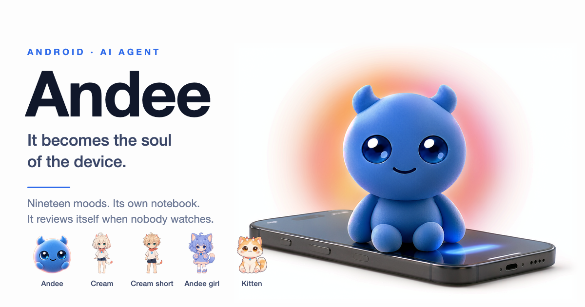
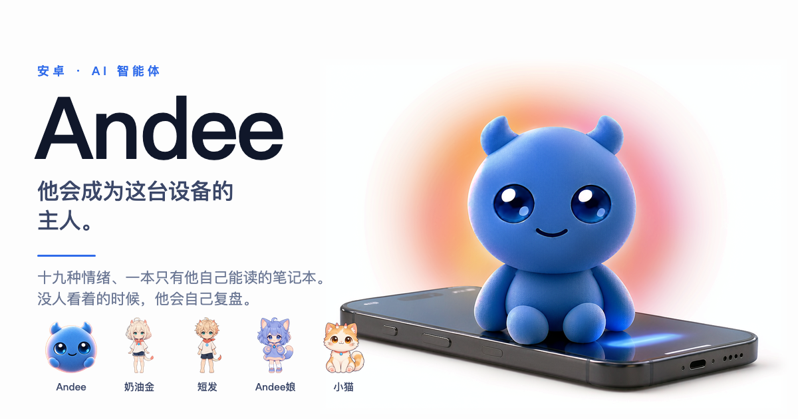

  
    

  
  <a href="https://www.codeflying.app/andee">Build online</a> ·  
  <a href="#install">Install</a> ·  
  <a href="docs/getting-started.md">Getting started</a> ·
  <a href="#what-it-does">What it does</a> ·  
  <a href="#why-it-is-not-a-phone-assistant">Why it is different</a> ·  
  <a href="docs/build-and-provision.md">Build from source</a> ·  
  <a href="docs/reference.md">Reference</a> ·  
  <a href="docs/permissions.md">Permissions</a> ·  
  <a href="SECURITY.md">Security</a> ·  
  <a href="DISCLAIMER.md">Disclaimer</a> ·  
  <a href="LICENSE">License</a>  

  
  <a href="#中文">中文</a> ·  
  <a href="#安装">安装</a> ·  
  <a href="docs/getting-started.zh-CN.md">入门指南</a> ·  
  <a href="docs/reference.zh-CN.md">参考</a> ·  
  <a href="docs/permissions.zh-CN.md">权限</a> ·  
  <a href="DISCLAIMER.zh-CN.md">免责声明</a>  

  
    
    
    
    
    
    
    

  
    
    

  

<h1 align="center">Andee</h1>

<h3 align="center">Anything you can do, it can — and it becomes the soul of the device.</h3>

  
  <b>Not the assistant that helps you operate your phone — not a tool, not a companion.  
  
  What moves in is not an app on the phone.</b>  
  
  A phone, a Mac, a tablet — each is a body it lives in. And the Andees on different devices can be **friends**.  
  
  No root. No custom ROM. <b>One APK on Android, one app on the Mac.</b>  

<table>
  <tr>
    <td><video src="https://github.com/user-attachments/assets/b092ec8d-d9ad-4f6b-9f5f-4312f5f1cedf" controls></video></td>
    <td><video src="https://github.com/user-attachments/assets/c54d8148-7ba9-4e5a-b5c9-de51839655ec" controls></video></td>
    <td><video src="https://github.com/user-attachments/assets/e79d05c3-5521-4679-8981-b6ba761be23a" controls></video></td>
    <td><video src="https://github.com/user-attachments/assets/71031c67-d53e-4b48-8c42-60417106fada" controls></video></td>
  </tr>
</table>

## Andee is a personal agent

Tell it what you want. It does it on your phone and on your Mac, the way you would: it opens the app, taps, types,
reads the screen. When a job is long, it hands it to a helper and keeps talking to you. It remembers you, and it
keeps working when you are not asking.

This is the shape DeepSeek calls a [Super Agent](https://github.com/deepseek-ai/dsh-superagent-prototype): one agent
that talks to you and keeps track of everything, and helpers that go off and do the long work. DeepSeek built theirs for a
team's GitHub repository and says it is a research prototype. Andee is the same idea for one person, on the
devices they already use.

| | **Andee** | OpenClaw | ChatGPT dots | Gemini on the phone |
| --- | --- | --- | --- | --- |
| Runs on | your own phone and Mac | your own Mac, Windows or Linux | OpenAI's cloud, each with its own cloud computer | Google's cloud |
| Works in any phone app, without the app doing anything | **Yes** | not stated | not stated | only supported apps, a few phones, US and Korea, beta |
| Works your computer | **Yes** | files, shell, browser | can link one computer | no |
| Remembers you between chats | **Yes**, in a notebook that stays on your device | yes | yes | not stated |
| Acts when you have not asked | **Yes**, with an off switch | not stated | not stated | recurring tasks |
| Hands long jobs to a helper while you keep talking | **Yes** (works from the Mac; phone to Mac not yet tested on a device) | not stated | not stated | not stated |
| Open source | Yes | Yes | No | No |

"Not stated" means their own pages do not say. It does not mean they cannot. The other columns come from
[OpenClaw's page](https://github.com/openclaw/openclaw),
[a comparison of nine assistants](https://resources.rework.com/tools/ai-agents/best-personal-ai-agents-2026) and
[a report on Gemini and Siri](https://blog.rottenwifi.com/gemini-leads-siri-in-android-app-automation-for-now/),
read in November 2026. Products change; check theirs.

## What it does

- **Any app, nothing to set up in the app.** It looks at the screen and taps like you do. On the Mac it also uses
  windows and a terminal, and asks you first before anything risky. If you can do it with your thumb, it can.
- **Long jobs go to a helper.** Research, a code repository, a pile of files, a command that runs for an hour. Andee
  gives it to an agent on your Mac ([DeepSeek Harness](https://github.com/deepseek-ai/deepseek-harness)) and
  keeps talking to you. When it is done, the files show up in the app and you open them there. Your phone can
  use the Mac's agent too.
- **It keeps track of what it took on.** Who it is waiting for, whether they answered, what it delivered. A job stays
  on the list until you say it is done, not when Andee says so.
- **It reads your notifications first.** It handles the ones you asked it to, tells you about the ones that matter in
  one sentence, and drops the rest.
- **It logs in for you without knowing your password.** The vault types it into the box. No tool can read it back.

## Why it is not a phone assistant

A phone assistant waits for you to ask. Andee does not wait.

- **It has its own notebook.** Who it is, what it cares about, the people it knows, a diary. It stays on your device.
  You can read every entry and delete any of them.
- **It works when you are not asking.** When a conversation goes quiet it looks back over it and finishes what it
  promised. It checks for things that have waited too long and works on them, with the same tools it has when you
  ask, but quietly: it does not speak, and what it did shows up in your timeline. You can turn this off in
  Settings, and one tap on the ball stops everything it is doing. What it may send to people, spend or delete is
  limited by rules, not by a lock. [SECURITY.md](SECURITY.md) says where those rules stop being enough.
- **It stays quiet by default.** A notification is either handled, mentioned in one line, or dropped with a note
  saying why. A message from a stranger cannot open your vault, no matter what it says. That check is in the code, not
  in the prompt.
- **It has its own face and voice.** Six looks and nineteen moods, and the model chooses the face as it speaks.
- **It has friends.** The Andees on your own devices can ask each other for help. So can someone else's, if its owner
  agrees, and then the job runs where it cannot see your memory.

It lives in two places today, an Android phone or tablet and a Mac, and it can drive a small robot dog. It is the
same Andee on both.

## Install

**Easiest: build it on [CodeFlying](https://www.codeflying.app/andee).** Open the page, tap build, scan the code to
download. The package already has the model and voice keys in it, so it can talk as soon as it is installed. New
accounts get a free allowance, then you pay for tokens. (中文：[codeflying.net/andee](https://www.codeflying.net/andee).)
CodeFlying is a separate service with its own terms, prices and data handling.

**Or download a release** from [GitHub](https://github.com/kuafuai/andee/releases/latest):

| Device | File | After installing |
| --- | --- | --- |
| Android phone or tablet (Android 8.1+) | `andee-<version>-en-android-arm64-v8a.apk` (nearly every device) | turn on Overlay, then Accessibility |
| Mac, Apple silicon (macOS 14+) | `andee-<version>-en-mac-arm64.dmg` | drag Andee to Applications; allow Accessibility and Screen Recording when asked |
| Mac, Intel | `andee-<version>-en-mac-x64.dmg` | same |

Release files have no keys in them. Put your CodeFlying key in ⚙ → **Backend**, or switch to On-device and enter your
own model and voice keys. Then tap the ball and talk. [Permissions](docs/permissions.md) explains why each one is
needed and what happens if you say no. [Getting started](docs/getting-started.md) is the short first-run guide.

## You can check all of this

There is no analytics SDK and no tracking of what you say. The only thing that reaches the maintainers is the update
check: the version number, phone model and brand, system version, interface language and a random install ID. The
whole agent loop is in this repository, including the parts that stop it from doing harm: the vault, the turns that
cannot touch it, the commands that need your yes. Where it falls short is written down in [SECURITY.md](SECURITY.md)
and the [disclaimer](DISCLAIMER.md).

[Build it yourself](docs/build-and-provision.md) ·
[Everything it can do, how it is built, the wake word, the robot dog](docs/reference.md) ·
[Changelog](CHANGELOG.md) · [Contributing](CONTRIBUTING.md) · [Report a vulnerability, privately](SECURITY.md)

## Showcase

**Built something with it? Show us.** The ones worth collecting are usually the ones nobody planned
— the odd workaround, the thing it turned out to be able to do, the one that made you laugh. It does
not have to be useful.

Post it in **[Show and tell](https://github.com/kuafuai/andee/discussions/categories/show-and-tell)**,
one case per post, so each one can be discussed on its own. Three things make a post useful to the
next person:

- **What it ran on** — device, Android version, ROM. This app talks to Android at a level where ROMs
  disagree, so "worked on my phone" tells a reader almost nothing.
- **What you asked for, and what it actually did** — the sentence you really said is more
  interesting than a summary of it.
- **A link, if you have one** — YouTube, Bilibili, X, your own blog, anything public. GitHub cannot
  play a video inside a README, so it will be a clickable link rather than a player. On YouTube you
  can make it a thumbnail that looks like one:

(substitute the id from the video's URL — `youtube.com/watch?v=VIDEO_ID`)

**One thing here is not a formality: this app reads the screen.** A screenshot or a recording is a
picture of your messages, your notifications, and whatever else happened to be open at the time.
Blur or avoid anything private — yours or anyone else's — before it goes up.

## Contributing

- **Code** — read [CONTRIBUTING.md](CONTRIBUTING.md) ([Chinese](CONTRIBUTING.zh-CN.md)) first. It covers
  the code style, and the rules for the three different kinds of Chinese in this codebase (only one
  of them is translated). Changing a persona or a mood has its own section there; that is not
  ordinary copy.
- **Bugs** — the issue tracker wants your **device, Android version, ROM and logcat**. This app
  talks to Android at a level where ROMs disagree: a call that works on AOSP can fail silently on
  MagicOS. Without that, most reports cannot be reproduced.
- **Personas and looks** — a new look writes tone and nothing else; capabilities belong to the
  rulebook, not to a character.
- **Docs and translations** — welcome. Both READMEs are now self-contained, so either one can be
  corrected on its own; the Chinese one is the one that has to stay accurate for provisioning, since
  it is the one most installers will read.

### Contributors

<!-- Replace with a real contributors image once the project has a public home.
     GitHub:  -->

<!-- Demo GIF, demo video and stills — the three assets this README still needs.
     Capture all of them on a real device; an emulator makes this app look like nothing.
       1. images/demo.gif                       10–15s loop: the ball reacting while a task runs
       2. a full demo video                     30–60s, GitHub attachment link (drag-drop upload), goes at the top
       3. images/shot-{ball,phone,dog}.png      three stills, including the dog mid-motion
     Shot list for the video, in order: wake it by voice → it opens an app and taps through it →
     the ball's face changes as it works → a page it wrote appears → the dog moving. The dog is the
     clearest single proof that this is a body and not a UI, so do not cut it for time. -->

## Community & contact

| Channel | Use it for |
|---|---|
| Issue tracker | Reproducible bugs, engineering work |
| Show and tell | What you built with it, fun or not — see [Showcase](#showcase) |
| Security | Vulnerabilities — privately, never in a public issue. See [SECURITY.md](SECURITY.md) |
| Product / online | Trying Andee without building it yourself — [codeflying.app](https://www.codeflying.app/andee) · [codeflying.net](https://www.codeflying.net/andee) |
| WeChat | Add Andee as a friend — scan the code below, or tap the WeChat icon at the foot of the chat |

## Security disclosure

Please do not open a public issue for a security problem. The private reporting channel and the
process are in **[SECURITY.md](SECURITY.md)**.

That document also lists the **known limitations** you should read before deploying this, including
one that matters on any network you do not control: the debug WebSocket server binds `0.0.0.0:9008`
and does not authenticate its clients. [docs/permissions.md](docs/permissions.md)
([Chinese](docs/permissions.zh-CN.md)) explains each permission against a concrete tool, and
[SECURITY.md](SECURITY.md) is honest about what is not fixed yet.

## Disclaimer and acceptable use

Two documents, and both are conditions of use rather than formalities. Each has a Chinese
counterpart (`*.zh-CN.md`), linked from the top of the file:

- **[DISCLAIMER.md](DISCLAIMER.md)** ([Chinese](DISCLAIMER.zh-CN.md)) — what this software is
  (experimental, no SLA, no warranty), **exactly where your data goes**, what it is actually
  capable of, and who bears the consequences.
- **[docs/acceptable-use.md](docs/acceptable-use.md)** ([Chinese](docs/acceptable-use.zh-CN.md)) —
  the prohibited uses. Violating them exceeds the licence and terminates it automatically.

The four points worth reading even if you read nothing else:

- **It can spend money.** There is no payment tool, and there does not need to be — it taps. The only
  thing blocking a completed transfer is Android's own `FLAG_SECURE`; **this project has no guardrail
  on that path.** Keep a human present for anything financial, and treat *"the AI did it"* as no
  defence, because it is not one.
- **What it sends is yours.** Messages, posts, calls and orders go out under your name.
- **Your data leaves the device.** There is no analytics SDK in this repo — but speech goes to
  whichever speech provider you select (Volcengine by default, Google if you pick it), the conversation
  plus every tool result goes to whichever brain endpoint you configure,
  and the version check goes to a server the maintainers run. Local mode changes the destination, not
  the fact.
- **It can be steered by what is on screen.** Anyone who can get you to open a page can influence it.

## License

[Apache-2.0 **with additional conditions**](LICENSE) — no multi-tenant SaaS, no white-labelling
that removes the branding, and no embedding it in another product without written authorisation.
GitHub reports this as `NOASSERTION`; that is expected, not a misconfiguration.

Bundled third-party components are inventoried in [THIRD_PARTY_NOTICES.md](THIRD_PARTY_NOTICES.md).
Read it before redistributing: **the ML Kit barcode SDK and the `play-services-*` stubs are not
open-source**, and the barcode model is fetched from Google at runtime.

See [CHANGELOG.md](CHANGELOG.md) for what changed and for the versioning policy. The latest release is
**`v0.15.0`** — pre-1.0 on purpose, because the wire contract and the build flags are still moving.

## Related documents

- [docs/getting-started.md](docs/getting-started.md) ([Chinese](docs/getting-started.zh-CN.md)) — the short first-run path from installation to a basic interaction
- [docs/permissions.md](docs/permissions.md) ([Chinese](docs/permissions.zh-CN.md)) — why it asks for
  the permissions it asks for, each one against a concrete tool
- [docs/architecture.svg](docs/architecture.svg) ([Chinese](docs/architecture.zh-CN.svg)) — the whole
  thing on one page: a turn in, the agent loop, six ways out
- [DISCLAIMER.md](DISCLAIMER.md) — where your data goes, what it can do, who bears the consequences
- [docs/acceptable-use.md](docs/acceptable-use.md) ([Chinese](docs/acceptable-use.zh-CN.md)) — the
  prohibited uses
- [SECURITY.md](SECURITY.md) — threat model, known limitations, vulnerability reporting
- [CONTRIBUTING.md](CONTRIBUTING.md) ([Chinese](CONTRIBUTING.zh-CN.md)) — contribution guide, including
  the rules for changing a persona
- [THIRD_PARTY_NOTICES.md](THIRD_PARTY_NOTICES.md) — dependency licence inventory
- [CHANGELOG.md](CHANGELOG.md) — what changed
- [CODE_OF_CONDUCT.md](CODE_OF_CONDUCT.md) — community conduct
- [CLAUDE.md](CLAUDE.md) — architecture tour

---

  

<h1 align="center">Andee</h1>

<h3 align="center">任何你能做的事情它都能，它会成为这台设备的主人。</h3>

  <b>他不是那种帮你操作手机的助手，也不是工具或伙伴 —— 
  住进来的不是一个 App，是一个灵魂。</b> 
  手机、Mac、平板，都是他住进去的身体；不同设备上的 Andee，还能成为<b>朋友</b>。 
  不用 root，不用刷机，不用插着电脑。<b>Android 上一个 APK，Mac 上一个 App。</b>

## Andee 是你的 Personal Agent

你跟它说想要什么，它就在你的手机和 Mac 上去做，跟你自己做一样：打开 App、点、打字、看屏幕。活儿太长，它就交给
帮手去干，自己继续跟你说话。它记得你，你没叫它的时候，它也在干活。

这就是 DeepSeek 说的 [Super Agent](https://github.com/deepseek-ai/dsh-superagent-prototype)：一个对着你、替你记账的
agent，加一群去干长活的帮手。DeepSeek 做的那个是给团队的 GitHub 仓库用的，他们自己说只是研究原型。Andee 是同一个
思路，给一个人用，装在他每天用的设备上。

| | **Andee** | OpenClaw（小龙虾） | WorkBuddy | 豆包手机 |
| --- | --- | --- | --- | --- |
| 跑在哪 | 你自己的手机和 Mac | 你自己的 Mac、Windows、Linux | 腾讯说操作在本地电脑完成 | 字节和中兴做的手机，助手在系统里 |
| 能在手机任何 App 里操作，App 不用做任何适配 | **能** | 没说 | 没说；手机端用来远程指挥电脑 | 第一代能；据晚点报道，新一代对头部 App 改成谈合作 |
| 能操作你的电脑 | **能** | 文件、命令行、浏览器 | 文件、PPT、浏览器 | 不适用 |
| 跨对话记得你 | **能**，记在你设备上的小本本里 | 能 | 没说 | 没说 |
| 你没开口它也行动 | **能**，可以关 | 没说 | 能，可设定时任务 | 没说 |
| 长活交给帮手，自己继续陪你 | **能**（Mac 上能用；手机连 Mac 还没在真机上测过） | 没说 | 没说 | 没说 |
| 开源 | 是 | 是 | 否 | 否 |

「没说」是指它们自己的页面没讲，不等于做不到。其余几列来自
[OpenClaw 的页面](https://github.com/openclaw/openclaw)、
[WorkBuddy 的腾讯云介绍](https://cloud.tencent.com/act/solution-ai-application1-17582)和
[媒体对豆包手机的报道](https://www.cnblogs.com/htai/p/21609949)（转述晚点 LatePost 7 月 17 日的消息），
2026 年 11 月读的。产品每个月都在变，请以它们自己为准。

## 它能替你做什么

- **任何 App，App 那边什么都不用做。** 它看着屏幕，像你一样点。在 Mac 上它还能用窗口和终端，有风险的先问你。
  你用手指能做的，它就能做。
- **长活交给帮手。** 查资料、改一个代码仓库、处理一堆文件、跑一个小时的命令。Andee 把它交给你 Mac 上的 agent
  （[DeepSeek Harness](https://github.com/deepseek-ai/deepseek-harness)），自己继续跟你说话。做完以后，文件在 App 里列出来，
  点开就能看。手机也能用 Mac 上的 agent。
- **它记着接下的事。** 在等谁、对方回了没有、交付了什么。一件事一直留在清单里，直到你说办完了，不是 Andee 自己说了算。
- **通知先过它这一关。** 你交代过要它回的，它去回；要紧的，一句话告诉你；其余的丢掉。
- **它替你登录，但不知道你的密码。** 保险箱把密码填进输入框，没有任何工具能把它读出来。

## 为什么它不是手机助手

手机助手等你开口。Andee 不等。

- **它有自己的小本本。** 他是谁、在意什么、认识的人、日记。都在你的设备上。每一条你都能看，都能删。
- **你没叫它，它也在干活。** 聊完安静下来，它会回头看一遍，把答应过的事做完。也会去看有什么放太久了，去处理。
  用的是你叫它做事时同样的工具，但是安静地做：不出声，做了什么会写在你的动态里。你可以在设置里关掉，点一下球，它手上的
  事全都停。至于它能替你发给谁、花多少钱、删什么，靠的是规则，不是一把锁。规则哪里不够，[SECURITY.md](SECURITY.md) 里写了。
- **它默认不吵你。** 一条通知，要么处理，要么一句话告诉你，要么丢掉并记下为什么。陌生人发来的消息，不管怎么写，
  都打不开你的保险箱。这个检查写在代码里，不是写在提示词里。
- **它有自己的脸和声音。** 六个形象、十九种情绪，说话的时候由模型自己挑表情。
- **它有朋友。** 你不同设备上的 Andee 可以互相求助。别人的 Andee 也可以，只要主人同意；这样活就跑在看不到你记忆的地方。

现在它住在两个地方，一台 Android 手机或平板，和一台 Mac，还能带一只小机器狗。两边是同一个 Andee。

## 安装

**最省事：到 [CodeFlying](https://www.codeflying.net/andee) 一键打包。** 打开页面点「立即打包」，扫码下载。包里已经配好了
模型和语音密钥，装上就能说话。新用户有免费额度，用完要买。（English：[codeflying.app/andee](https://www.codeflying.app/andee)。）
CodeFlying 是独立的服务，条款、价格和数据怎么处理，都由它自己定。

**也可以直接下载发布包**，在 [GitHub Releases](https://github.com/kuafuai/andee/releases/latest)：

| 设备 | 下载哪个 | 装好之后 |
| --- | --- | --- |
| Android 手机或平板（Android 8.1+） | `andee-<版本>-zh-android-arm64-v8a.apk`（几乎所有设备） | 开悬浮窗，再开无障碍 |
| Mac，Apple 芯片（macOS 14+） | `andee-<版本>-zh-mac-arm64.dmg` | 把 Andee 拖进「应用程序」；它要「辅助功能」和「屏幕录制」时允许 |
| Mac，Intel | `andee-<版本>-zh-mac-x64.dmg` | 同上 |

发布包里没有密钥。在 ⚙ → **后端** 里填 CodeFlying 的密钥，或者切到「本机」填你自己的模型和语音密钥。然后点那颗球，说话。
每项权限为什么要、拒绝了会怎样，见[权限](docs/permissions.zh-CN.md)；第一次上手看[入门指南](docs/getting-started.zh-CN.md)。

## 这些你可以自己查

没有数据分析 SDK，也不追踪你说了什么。会到维护者手上的只有版本自检：版本号、手机型号和品牌、系统版本、界面语言，
加一个随机安装 ID。整个 agent 的循环都在这个仓库里，包括那些防它做坏事的部分：保险箱、碰不到保险箱的那些轮次、要你点头才能跑的命令。
它在哪里做得不够，写在 [SECURITY.md](SECURITY.md) 和[免责声明](DISCLAIMER.zh-CN.md)里。

[自己构建](docs/build-and-provision.zh-CN.md) ·
[它能做的一切、怎么搭的、唤醒词、机器狗](docs/reference.zh-CN.md) ·
[变更记录](CHANGELOG.md) · [参与贡献](CONTRIBUTING.zh-CN.md) · [私下报告漏洞](SECURITY.md)

## 好玩的用法

**用它做过什么？说来听听。** 值得收的往往不是"正经用途"—— 是你绕的那个弯、是它居然真能做成的
那件事、是把你逗乐的那一下。**不实用也可以。**

发到 **[Show and tell](https://github.com/kuafuai/andee/discussions/categories/show-and-tell)**，
一个帖子讲一个，这样每个都能单独聊。想让下一个人看得懂，三件事最好带上：

- **跑在什么机器上** —— 机型、Android 版本、ROM。这个应用和 Android 打交道的层次上，各家 ROM 是
  有分歧的，"我手机上能用"对别人几乎等于没说。
- **你说了什么，它真做了什么** —— 你原话那句，往往比概括出来的有意思。
- **有链接就贴** —— YouTube、B站、微博、自己的博客，公开的就行。GitHub 的 README 放不了视频
  播放器，它只能是个可点的链接。YouTube 的话可以做成缩略图，看起来就像个播放器：

（把 `VIDEO_ID` 换成视频地址里的那一段 —— `youtube.com/watch?v=VIDEO_ID`）

**有一件事不是客套：这个应用是读屏幕的。** 截图或录屏，就是你消息、通知、当时开着的一切的实拍。
发之前把涉及隐私的地方挡掉 —— 你自己和别人的都算。

## 参与贡献

- **代码** —— 先读 [CONTRIBUTING.zh-CN.md](CONTRIBUTING.zh-CN.md)。里面有代码风格，以及这个仓库里**三种
  中文只有一种要翻译**的规则。改人格或情绪有单独一节，那不是普通文案。
- **报 bug** —— 请务必带上**设备型号、Android 版本、ROM 和 logcat**。这个应用和 Android 打交道的
  层次上各家 ROM 是有分歧的：AOSP 上能用的调用在 MagicOS 上可能静默失败。缺这些，多数报告没法
  复现。
- **形象与人设** —— 新形象只写语气，不写能力。能力属于行为准则，不属于某个角色。
- **文档与翻译** —— 欢迎。中文 README 是装机那份，必须保持准确。

### 贡献者

<!-- 项目有公开主页后换成真实的贡献者图：
      -->

<!-- 素材清单：这三份是这份 README 与"完工"之间的全部差距。请用**真机**录 —— 模拟器会把 Andee
     拍得一无是处。
       1. images/demo.gif                       10~15 秒循环：球在反应、任务在跑
       2. 完整演示视频                          30~60 秒，GitHub 附件链接（拖进网页编辑器生成），放开头
       3. images/shot-{ball,phone,dog}.png      三张静帧，其中一张要拍到狗在动
     **演示该拍什么**，按顺序：语音叫醒它 → 它自己打开一个 App 点进点出 → 干活时那颗球的表情在变 →
     它写的一页东西出现 → 机器狗动起来。狗是"这是身体不是界面"最直接的一条证据，别为了时长把它剪掉。 -->

## 社区与联系

<!-- 有公开主页后把 Issue 跟踪 / 讨论区两行补上，不适用的删掉。
     不要发布会 404 的链接 —— 死掉的渠道比没有渠道更糟。 -->

| 渠道 | 用来做什么 |
|---|---|
| Issue 跟踪 | 可复现的 bug、工程事项（**请带上设备型号 / Android 版本 / ROM / logcat**） |
| 讨论区 / 问答 | 装机求助、想法、"这个能不能做" |
| 好玩的用法 | 你用它做过什么，实用不实用都行 —— 见[好玩的用法](#好玩的用法) |
| 安全 | 漏洞 —— 走私密渠道，永远不要开公开 issue。见 [SECURITY.md](SECURITY.md) |
| 产品 / 在线 | 不想自己打包就想试 Andee —— [codeflying.net](https://www.codeflying.net/andee) · [codeflying.app](https://www.codeflying.app/andee) |
| 微信 | 加 Andee 为好友 —— 扫下面的码，或者点聊天页底部的微信图标 |

## 安全披露

安全问题**请不要开公开 issue**。私密上报渠道和处理流程在 **[SECURITY.md](SECURITY.md)**。

那份文件同时列出了**部署前必须知道的已知限制**，其中一条在任何你控制不了的网络上都成立：调试
用的 WebSocket 服务绑在 `0.0.0.0:9008` 且不验证客户端身份。本应用申请的权限组合与安卓银行木马
的检测特征高度重合 —— [docs/permissions.zh-CN.md](docs/permissions.zh-CN.md) 把每一条对应到一个具体工具，
而 [SECURITY.md](SECURITY.md) 对"还没修的"是诚实的。

## 免责声明与可接受使用

两份文件，都是**使用条件**，不是客套。中文版在这里，英文版见各自的对照文件：

- **[DISCLAIMER.zh-CN.md](DISCLAIMER.zh-CN.md)**（[English](DISCLAIMER.md)）—— 这是什么性质的
  软件（实验性、无 SLA、无担保）、**你的数据到底去了哪里**、它实际能做到什么、以及出事后由谁承担。
- **[docs/acceptable-use.zh-CN.md](docs/acceptable-use.zh-CN.md)**（[English](docs/acceptable-use.md)）
  —— 明确禁止的用途。违反即超出许可范围，许可**自动终止**。

就算其余都不看，这四条也请看完：

- **他能花钱。** 项目里没有支付工具，也不需要 —— 他直接点。唯一挡住一笔转账的是 Android 自己的
  `FLAG_SECURE`，**本项目对这条路径没有任何技术围栏**。任何涉及钱的操作都要人在场；并且请记住
  **"是 AI 自己做的"不是抗辩理由**，因为它确实不是。
- **他发出去的东西是你的。** 消息、帖子、通话、订单，署名都是你。
- **你的数据会离开设备。** 本仓库里没有数据分析 SDK，但语音会走你选的那家服务商（默认火山，
  也可以选 Google），对话连同**全部工具返回
  结果**会走到你配置的那个大脑端点，版本自检会走到一台维护者自己跑的服务器。"本机模式"换的是
  目的地，不是这个事实。
- **他能被屏幕上的字操纵。** 任何能让你打开一个页面的人，都可能影响到他。

## 许可

[Apache-2.0 **加附加条件**](LICENSE) —— 禁止多租户 SaaS、禁止去 LOGO 白标。GitHub 会把它显示成
`NOASSERTION`，这是预期的，不是配置错误。

随包分发的第三方组件清单在 [THIRD_PARTY_NOTICES.md](THIRD_PARTY_NOTICES.md)。再分发之前请先看：
**ML Kit 扫码 SDK 和 `play-services-*` 不是开源许可**，而且扫码模型是运行时从 Google 拉的。

改了什么、以及版本号策略见 [CHANGELOG.md](CHANGELOG.md) —— 当前版本是 **`v0.15.0`**，故意停在
pre-1.0：线上协议和构建开关都还在动。

## 相关文档

- [docs/getting-started.zh-CN.md](docs/getting-started.zh-CN.md)（[English](docs/getting-started.md)）—— 从安装到第一次基本互动的最短路径
- [docs/permissions.zh-CN.md](docs/permissions.zh-CN.md)（[English](docs/permissions.md)）—— 权限为什么这么要
- [docs/architecture.zh-CN.svg](docs/architecture.zh-CN.svg)（[English](docs/architecture.svg)）—— 一页看全：一轮怎么进来、agent loop、六个出口
- [DISCLAIMER.zh-CN.md](DISCLAIMER.zh-CN.md) —— 免责声明：数据去哪、能做什么、出事谁担
- [docs/acceptable-use.zh-CN.md](docs/acceptable-use.zh-CN.md) —— 可接受使用政策（禁止用途）
- [SECURITY.md](SECURITY.md)（英文）—— 威胁模型、已知限制、漏洞上报
- [CONTRIBUTING.zh-CN.md](CONTRIBUTING.zh-CN.md)（[English](CONTRIBUTING.md)）—— 贡献指南（含改人格的规范）
- [THIRD_PARTY_NOTICES.md](THIRD_PARTY_NOTICES.md) —— 依赖许可证清单
- [CHANGELOG.md](CHANGELOG.md) —— 变更记录
- [CODE_OF_CONDUCT.md](CODE_OF_CONDUCT.md)（英文）—— 社区行为准则
- [CLAUDE.md](CLAUDE.md) —— 架构导览（英文）
