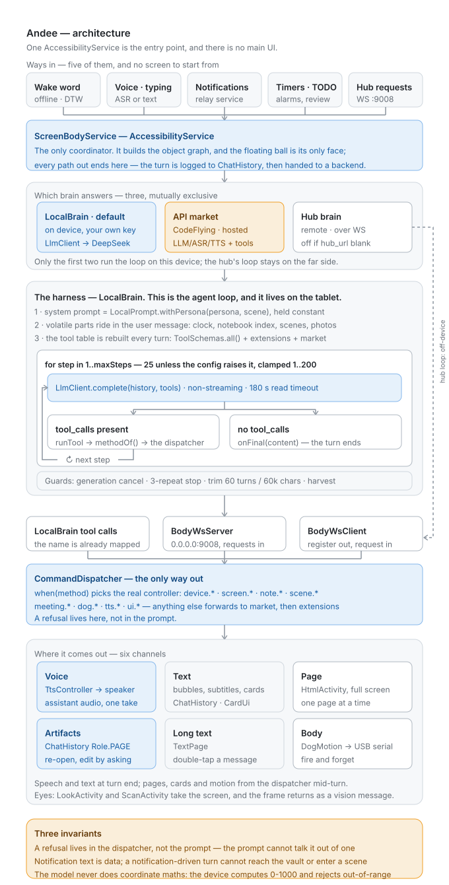

# Reference

> Moved here from the README: the parts that matter once you are using it, not when you are deciding to.

### Key features

#### Hands — it uses your phone the way you do

**1. Any app, no integrations.**  
It reads the screen as a compact element outline — one indented line per element, with an id it can  
tap — and when the app draws its own pixels (mini-programs, WebViews, games) it falls back to the  
screenshot. General-purpose models are bad at computing coordinates and good at reading them, so it  
**never does the maths**: every screenshot it sees carries a faint labelled 8×12 grid, it taps by  
*cell + which part of it*, and for tight targets it zooms in and sees a magenta crosshair where the tap  
would land before committing. A per-location guard refuses the fourth tap on the same spot, so a  
confused model stops and asks instead of hammering.

**2. It types like a keyboard, without being one.**  
On Android 13+ it types through the accessibility service's own input channel — the same  
`commitText` path a keyboard uses, into the focused field, **while your own keyboard stays active**.  
Nothing to install, nothing to switch. Older devices fall back to ADBKeyboard.

**3. A few dozen tools, held to honest failure.**  
Screen, input, notifications, SMS, calls, contacts, calendar, location, camera, meetings, TTS/ASR,  
and the dog. Every one checks its runtime permission *before* acting and reports `denied("sms")` rather  
than working around a refusal. Tools return what they saw, not what was hoped for.

**4. It can log in as you without ever holding your password.**  
The vault (Keystore AES-GCM, on the device) stores your accounts; the brain can list them and have the  
password **typed** into the focused field, but no tool will ever return it — not even masked. You see  
every fill on the ball as it happens.


#### Mind — it gets to know you

**5. Scenes: ways of working, ready-made or learned with you.** *(new)*  
"Keep an eye on my messages", "book it for me when it opens" — a scene is a goal, a voice, rules and a  
routine it steps into for a while. Four are ready-made and sit under **Scenes → Ready-made scenes**,  
saved only when you tap Adopt. Beyond those it **learns** its own: after the same kind of session comes  
up a few times, it proposes one; nothing is saved until you say yes. Enter one by saying so, from the  
**Scenes** panel, on a schedule, or automatically when you open an app. A scene's own rules decide how  
much it does on its own — "answer my messages for me" really means it answers. While you are in one, a  
chip under the ball names it; its ✕ leaves it.

**6. It reads your notifications before they interrupt you.** *(new)*  
A cheap, tool-less model call (~500 tokens, against ~22,000 for a full turn) classifies each one:  
**act** on it, **tell** you in a single spoken sentence, or **ignore** it and log why. It is biased  
toward silence, and when it cannot decide it falls back to asking you. The text came from a stranger,  
so it is fenced as data — and a notification-driven turn is **mechanically barred** from the vault  
and from creating or entering a scene, whatever the model was talked into.

**7. Its own memory and its own schedule.**  
`config/Notebook.kt` is what it remembers about the person, and what it promised to do later. One  
test decides what gets written: *"next time I deal with them, would not knowing this make me get  
it wrong?"* The notebook is **private** — the tools are `localOnly` and filtered out of the hub  
payload, so habits and promises never leave the device. On top of it sits a real scheduler, under  
a hard rule: the moment it says "I'll remind you", the task must already be set and confirmed. And it  
is yours to read: the **notebook** has nine tabs — Guard · Self · Cares · Diary · Plan · People · Wiki ·
Memories · **In hand** — and every memory there is deletable. **In hand** is what it has taken on, not a
list of alarms: a thing with an end that can outlive the turn it started in (asked in group B, waiting on
someone in group C) shows up there, until it is delivered.
**Finished topics get put away, not deleted.** A conversation that has ended is the most expensive
thing in every later request and the least likely to be needed again, so the nightly review folds it
into a titled summary with a one-line marker left in its place — and the verbatim conversation is
archived beside it. The scrollback shows a card where those messages stood, offering **Continue**,
**Transcript** and **Made here**; it can read the full transcript back when you ask about a detail the
summary left out, rather than answering from the summary or saying it never happened.

**8. It behaves the same when nobody is watching.**  
After a conversation goes quiet the device sends a `(to yourself …)` turn — Andee reviewing the  
conversation alone, *"nobody is watching you, nobody is waiting for you to answer."* Two rules:  
make no sound, and do not touch the device. It closes out its own promises, notes which habits are  
worth turning into a scene next time, and ends empty-handed rather than inventing something to record.

**9. It has things of its own.** (new)
It keeps **who it is** (a short first-person account it rewrites as things happen), **what it cares about** (a
community you handed it, something it promised someone, a question it wants to work out — each with how often it
means to look), **the people it knows** (only the ones it has actually dealt with, never copied from your
contacts), and a **wiki** (the plans, research and reviews it writes, as Markdown files you can open and send on).
Every night it writes a **diary** page in its own voice — a status report is refused.
**It gets up by itself, with nobody asking**: while you are using the device it checks about every 20 minutes
whether something has waited too long, and if so works on it for a while — writing a plan, tidying the people it
knows, noting a thought, at most one bubble. It **does not touch the screen, speak, or send anything for you**
then, and the device enforces that. How overdue something is, and whether it got done, are counted by the device
from the record, not taken from the model. Settings → On its own turns it off.

#### Face — a character, not a theme

**9. Six looks, nineteen moods, and a face it chooses.**  
Cream, Pigsy, Rascal, Bear and Imp, drawn live in hand-written OpenGL  
ES. Nineteen moods (`ui/ball/Mood.kt`) arbitrate between what it feels, what the voice pipeline is  
doing, and what work is in flight, plus an idle fidget pool that never repeats the same gesture twice  
in a row, *"because a repeat reads as a stuck animation, not a personality."* The model now picks its  
own expression **mid-sentence** — `[happy] Found it, page three. [calm] Want me to open it?` — and the  
face changes in step with the audio. Swipe the ball to change who you are talking to: a look carries a  
`persona` (how it talks) and a `voice` (how it sounds).

**10. Character is delivery, never a licence.**  
§12 of the prompt subordinates the persona to everything above it: it may change wording, rhythm,  
and how it sounds about the task — never what it does, what it is willing to do, or what it tells  
the user is true. And when something is genuinely wrong, the mask comes off.

#### Show and tell

**11. Talk, type, or show it a photo.**  
Tap the ball, or say "Hey Andee" (fully offline wake word). Prefer typing? The typing field takes  
up to six photos — from the camera or the gallery — with or without words.

Tap the ball or use the wake word, then say "Exit Andee" or "Take a break" to stop the task and close Andee.
Automatic follow-up listening cannot trigger exit; exit is declined while a meeting is recording.
The microphone and wake listener stop. Tap the app icon to reopen; Android accessibility reconnection may also restart Andee.

**12. Answers you can keep.**  
Anything structured — a comparison, a plan, meeting minutes — comes back as a page it writes and  
puts on screen. The **Made for you** panel keeps one row per page and holds the revisions behind it —
up to twenty of each — so you can reopen it, delete it, or have it revised by just saying what should
change. **A revision is a new version of the same page, not a second page**, and any earlier version
can be made current again. Ask it to record a meeting and it holds the microphone
for the hour, writing a verbatim transcript to disk as it goes, then turns it into minutes.

#### Body

**13. A body, not a screen.**  
The device is what Andee wears. Camera as eyes, ASR plus an offline wake-word as ears, the  
accessibility service as hands, and — when one is attached — a robot dog as **a leg**. The prompt  
is explicit that it is not a pet on a remote: *"you have not gained a subordinate, you have gained  
a body part."* Bodies differ, so it checks rather than assumes.

**14. A robot dog counts as a leg.**  
The dog is not a smart-home accessory bolted onto a phone app. It runs through a USB OTG dongle  
(Arduino Nano + NRF24L01) on the same body, so a single request — *walk to the kitchen and tell me  
what is on the counter* — can move a physical object and look through a camera, in one task. Turns  
are closed-loop on the phone's own gyroscope, and a tilt past the fall threshold stops it on the  
device without waiting for the brain. Its own safety rules are not negotiable: the original remote  
must be off, the dog refuses to advance inside 20cm of an obstacle, and **if the dongle is unplugged  
mid-motion the body cannot send a stop** — the dog finishes its last action. That last one is a  
firmware limitation this app does not paper over. If you attach a dog, read  
[The robot dog](#the-robot-dog-usb-dongle) before the first move.

**15. The brain is detachable from the body.**  
It runs on the device itself (`brain = local`, the default, calling any OpenAI-compatible endpoint)  
or lives somewhere else and reaches the device over a WebSocket hub. The wire between the two is a  
plain tool-schema contract, so either half can be replaced without rewriting the other. That is what  
makes "any smart hardware as a body" a fact here rather than an aspiration.

#### Two bodies, and friends

**16. The same individual on the Mac.**  
The agent loop, the prompt, the notebook format, the scenes and the guard rails live in `core/` and are the
same code on both. What the Mac adds is its own hands: the accessibility tree of any app, real mouse and
keyboard events, screenshots through ScreenCaptureKit, and **a terminal** — every command classified by risk,
run in a sandbox that cannot read Andee's own data, deletions sent to a trash it can undo, and anything
destructive asked about first. The window looks and behaves like the phone's card: the ball on top, the
conversation underneath, the same gestures.

**17. Friends: Andees that ask each other for help.** *(new)*  
Pairing is a QR code: one device shows it, the other scans it. The code dies in two minutes or three wrong
tries, and the QR names the shower's key, so the scanner pins that key and no other; after that every link
is a signed, encrypted channel with forward secrecy. To the model a friend is like a tool on a shelf — each
says what its body is and can do (`list_friends`) — and `ask_friend` hands it a job. The answer comes back
later as its own turn; nothing waits.  
Two kinds, decided by whoever shows the code: **my device** (trusted like you, same conversation) and
**friend** (somebody else's). A friend's request puts a card in front of its owner — allow, always allow,
decline — and runs in a throwaway brain that has the screen and nothing of the owner's life: no memory, no
history, no vault, no contacts, no terminal, on an allow-list. A notification's turn cannot ask a friend,
and a request handed over cannot be handed on. Same Wi-Fi only, for now.

#### Engineering

**18. No DI framework, no coroutines on the phone, and nothing copied in.**  
On Android, deliberately no Compose either: overlays cannot host it, so all UI there is hand-written `View`
code; there is one service, so dependencies are constructor-injected by hand; concurrency is `Handler` plus
dedicated executors. The Mac is Compose Desktop, because it has real windows. All first-party code.

### Architecture

Three Gradle modules: **`core/`** (the brain, the prompt, the tool schemas, the friend link — plain JVM,
shared), **`app/`** (the Android body) and **`desktop/`** (the Mac body). Each body implements one interface,
`BrainHost`, and the brain never sees an Android or a desktop type.

On Android, one foreground service is the body and there is no main UI. A turn can begin five ways —  
the offline wake word, voice or typing, a notification, a timer, or a request over WebSocket — is  
logged to `ChatHistory`, and is handed to whichever backend is in effect (`brain = local` is the  
out-of-box default).

The agent loop **is** `LocalBrain`. It holds the system prompt constant and inlines the volatile  
parts (clock, notebook index, scenes, pages, photos) into the user message, so the provider's prefix  
cache still hits; it rebuilds the tool table every turn; and it calls the model in a **non-streaming**  
`for` loop of up to `maxSteps` steps. A reply carrying tool calls goes through `methodOf()` to the  
one `CommandDispatcher`; a reply without any ends the turn. The result comes back out through six  
channels — speech, text, a full-screen page, saved artifacts, long text, and physical motion.



Everything drawn here is in this repository, down to the guard rails — see  
[Why you can check this instead of trusting it](#why-you-can-check-this-instead-of-trusting-it).

### What it looks like

There is no home screen. What exists:

- **A floating ball.** On the phone the entire UI is `TYPE_APPLICATION_OVERLAY` layers added through  
  `WindowManager` (`ui/FloatingWindowUi`). Unfolded, it is a full-screen card: the ball's face on top
  with a speaker key beside it (answers read aloud, or not), the conversation underneath, an input pill at
  the foot — camera, album, words, send — and a control bar: **Made for you**, **Notebook**, **Scenes**,
  **Friends** (with a count), **✓** (self-check), **⚙** (settings). Looks, gear and the vault open from ⚙.
  When it starts working another app it folds into a ball in the corner and gets out of the way.
- **The ball's gestures are the same everywhere:** tap stops whatever it is doing and listens; double-tap
  stops and opens typing; swipe sideways to change character; long-press opens the card or window.
- **On the Mac,** a floating ball above every app and a chat window with the same doors down the side —
  Chat, Made for you, Notebook, Scenes, Friends, then Self-check and Settings — and the ball above the
  conversation.
- **The launcher icon opens two doors.** With the assistant running, it unfolds the card — exactly  
  what a long-press on the ball does. With accessibility off, it shows the self-check card instead,  
  because that is the one moment the phone has nothing else to tell you why it is doing nothing.
- **`ScreenBodyService`** (`AccessibilityService`) — the whole job. It builds the object graph and  
  starts both network paths.

A handful of transient activities (`PermissionRequestActivity`, `ScanActivity`, `LookActivity`,  
`HtmlActivity`, `TextInputActivity`) exist only to borrow a system capability for a moment. They are  
not pages.

### Permissions: why each one, and what happens if you refuse

This deserves its own section, because the honest version is uncomfortable to read: **the  
permission set this app asks for — accessibility, overlay, notification access, SMS, call log,  
contacts, and the installed-app list — is the same set Android banking trojans are detected by.**  
A security researcher will flag the manifest on sight. That is a reasonable first reaction, and it  
is worth answering rather than dodging.

**The design rule is per-call, not at-startup.** `device/DeviceCommsController.kt` calls  
`ensurePermission()` before *each* sensitive operation and **degrades gracefully when refused** —  
it returns `denied("sms")` and the job stops there. It does not ask for everything at install time  
and it does not lock you out if you say no. That is the opposite of the pattern most Android apps  
in this category use, and it is the single most important thing to understand about this codebase  
before judging the manifest.

Four capabilities are genuinely all-or-nothing, and each is worth stating plainly:

| Capability                                       | Buys you                                                              | If you refuse                                                                                          |
| ------------------------------------------------ | --------------------------------------------------------------------- | ------------------------------------------------------------------------------------------------------ |
| **Overlay** (`SYSTEM_ALERT_WINDOW`)              | The ball, subtitles, settings — the entire visible surface            | **Nothing is visible at all.** The only genuinely all-or-nothing grant                                 |
| **Accessibility service**                        | Every `screen.*` tool: tap, type, swipe, screenshot, read the UI tree | The hands are gone. The ball still appears and the dog still works, but it can no longer act on screen |
| **Microphone** (`RECORD_AUDIO`)                  | Streaming ASR and the wake word                                       | Tapping the ball does nothing. A conversation driven from the hub still works                          |
| **USB device** (per-device prompt, not a toggle) | The robot dog                                                         | It is treated as "no dog attached". It will not mention the absence                                    |

Everything else is on-demand and reversible: SMS, call log, contacts, calendar, location, activity  
recognition, camera, installed apps, battery-optimization exemption. Refuse any of them and that one  
capability disappears; nothing else changes. The full per-permission table, mapped to the exact tool  
that needs it, is in **[docs/permissions.md](../docs/permissions.md)**  
([Chinese](../docs/permissions.zh-CN.md)), and the copy for each prompt already exists in  
`device/PermissionsController.kt`.

#### Switching each one on

**Overlay.**

*Why:* the entire UI — ball, subtitles, settings panel — is a `TYPE_APPLICATION_OVERLAY` layer added  
through `WindowManager`. There is no Activity home screen for it to live in instead.

*How:* Settings → Apps → Andee → Permissions → Display over other apps. Or Settings → Apps &  
notifications → Special access → Display over other apps → Andee → on. The first launch usually  
raises a prompt, and tapping "go to settings" from it is the quickest route.

*Verify:* restart the app once the grant is in — the ball should be there immediately.

**Accessibility service.**

*Why:* every screen action — `get_screen_element` / `tap_screen_element` / `swipe_by_coordinates` /  
`type_text` / `submit_input` / `take_screenshot` / `system_action` — goes through the  
`AccessibilityService`. On a non-rooted device it is the only route to real touch events, to reading  
any app's UI tree, and to the system screenshot API.

What the manifest declares (`res/xml/accessibility_service_config.xml`):

- `canPerformGestures` — dispatch touch gestures
- `canRetrieveWindowContent` — read the whole UI tree
- `canTakeScreenshot` — system screenshots (API 30+)

*How:* Settings → Accessibility → Downloaded services / Installed services → **Andee** → on. Android  
then shows the large red warning that the service can view everything you do; confirm it. Some vendor  
ROMs (Xiaomi / Huawei / HONOR) additionally want "allow background pop-ups" or "show on lock screen" —  
turn those on too.

*Verify:* logcat shows `Body: ws server started on 0.0.0.0:9008`, which means `onServiceConnected`  
fired. Then tap `☰` (UI tree) or `◉` (screenshot) on the ball's top bar; the subtitle line should  
report success and a filename.

*Note:* most vendor ROMs **switch this grant off again** after every system update and every  
force-stop. That is ROM behaviour, and not something the app can prevent.

*Some apps hand it a blank screen instead of their real UI.* They serve **every**  
accessibility client an empty placeholder, not just Andee — and it is not Andee's fault:  
the system's own `uiautomator dump` gets the same blank page. The one we measured is WeChat, on a  
Xiaomi Pad 5 with MIUI and WeChat 8.0.78: it only shows its real UI tree when MIUI's hidden  
**`MiuiEnhanceTBService`** is enabled. That is a TalkBack companion service, and it has no switch  
in Settings. With it on, the same chat screen dumps 219 nodes. With it off, it dumps none. MIUI  
also turns that service on and off by itself whenever Andee is re-bound (after a reinstall, a  
crash, or a toggle). That is why WeChat could be read **sometimes but not always**, and why  
toggling Andee never actually fixed it. Matching the helper's accessibility config does not help  
either: WeChat checks which service is asking, not what it asked for.

What Andee does about it (`screen/TreeHelper.kt`): when a dump comes back blank like this, Andee  
**adds** that service to the enabled list and dumps again. It never removes anything. It does  
nothing on devices that don't have that component. It writes a line in the chat history so you  
know your system settings changed. It also tries at most once a minute, so if you turn the  
service off on purpose, Andee won't keep turning it back on. Writing that list needs one grant  
that only adb can give. It is the same grant the ADBKeyboard fallback uses:

```bash
adb shell pm grant net.kuafuai.andee android.permission.WRITE_SECURE_SETTINGS
```

Without the grant, nothing breaks. On the blank screens, Andee works from screenshots and  
coordinates instead of the element list. That is slower and less precise, but the task still  
gets done.

**Microphone.**

*Why:* ASR is streaming, so it needs the PCM stream upstreamed.

*How:* the first tap on the ball triggers ASR and Android asks — "while using the app" and "always"  
both work. If it was refused earlier: Settings → Apps → Andee → Permissions → Microphone → Allow.

*Verify:* tap the ball once. `listening…`, or live ASR text appearing in the subtitle line, means it  
is through.

### Why you can check this instead of trusting it

Most claims in this category — including the well-funded ones — are launch claims that no outside  
party has audited. This project's claims are duller and checkable, in code you can read right now:

- **No analytics SDK, and none of your content reaches us.** Not "we anonymise it", not "opt out in  
  settings": there is no analytics SDK in this repo. The one thing that does reach the maintainers is  
  the version check — your version number, phone model, brand, OS release, UI language and a random  
  per-install ID, and nothing else. Field by field, in  
  [docs/permissions.md](../docs/permissions.md).
- **The notebook cannot leave the device.** It is not a policy, it is a filter:  
  `net/ToolSchemas.kt` drops every `localOnly` tool from the hub payload before it is registered.  
  Habits and promises are physically incapable of being sent.
- **The wake word is fully offline.** Local MFCC + DTW template matching (`app/.../wake/`). It  
  stores feature vectors, never audio, and it never touches the network.
- **A message from a stranger cannot hand it permissions.** A turn started by a notification runs  
  with `untrusted = true`, and `CommandDispatcher.dispatch` refuses the whole `device.vault.` prefix  
  and `scene.save` / `scene.enter` / `scene.delete` on it — in code, not in the prompt. The prompt is  
  the first layer; this is the one that holds when the prompt is talked around.
- **The local brain needs no vendor backend.** `brain = local` against any OpenAI-compatible  
  endpoint is a supported mode, not a degraded one.
- **What is *not* fixed is written down.** [SECURITY.md](../SECURITY.md) lists five known limitations,  
  including that the debug WebSocket server binds `0.0.0.0:9008` without authenticating clients and  
  that the vault is not yet bound to device unlock. Read it before running this on a network you do  
  not control.


The trade is deliberate: a smaller claim that holds, over a bigger one that has to be taken on  
faith.

### Research and design notes

`reports/` is part of the repo, not scratch space. It holds the labs and audits this project was  
actually built against — the ball-face labs used to verify expressions by measuring pixels, the  
fact-check that overturned a wrong assumption about phone harnesses, the plan that produced the  
notebook, and the open-source readiness audit that found the device serial numbers in git history.  
If you want to see how the decisions were made rather than only what was decided, read those.

### Using Andee

- **Online — no local build, no token setup.** **[codeflying.app](https://www.codeflying.app/andee)** ·  
  **[codeflying.net](https://www.codeflying.net/andee)** (Chinese) — a general platform for describing an app  
  in words and having it developed and published. **A separate service, not part of this project.**  
  Describe the Andee you want, and it hands you an installable package with the keys already  
  configured — nothing to compile locally, and nothing about Android to understand first. A free  
  token allowance gets you started; it is finite, and once it runs out, tokens are purchased.
- **Self-hosted.** Clone, build, install. See [Build from source](build-and-provision.md#build-from-source) and the provisioning  
  walkthrough in [Provisioning](build-and-provision.md#provisioning). Point it at any OpenAI-compatible endpoint and it  
  runs with no private backend at all.
- **Bring your own body.** The tool contract is the seam. Anything that can speak it — a phone, a  
  tablet, a different piece of hardware — can carry the same individual.

### Wake word

If you would rather not tap the ball every time, teach it your voice: **⚙ → wake word → record wake  
word**, and say the phrase you want to use three times as prompted (for example "Hey Andee" — any  
other phrase works too, as long as you say the same one each time). After that, saying it does exactly
what tapping the ball does — **the screen does not have to be on**, unless you turn that off.


A few things worth knowing first:

- **Do not pick something too short.** Aim for a phrase that takes at least half a second to say.
  Very short words are easy to confuse with other sounds, and anything under 350 ms is dropped before
  it is recorded.

- **It is fully offline.** Recognition is local MFCC + DTW template matching (`app/.../wake/`): no
  network, no cost, and all it stores is a feature vector — the audio itself never touches disk. The
  price is that it recognises **you** saying that phrase. Someone else calling it, or a very different
  tone, may not wake it. If it does not wake, tap the ball; nothing else is affected.
- **Do not over-enunciate when you record.** The threshold is derived from the spread between your
  three takes: pronounce it too perfectly and the threshold tightens so much that your ordinary voice
  no longer matches.
- **It listens with the screen off too, and that is a setting you can turn off.** Screen off no longer
  hands the microphone back, because a screen being off is the normal state of a phone in a pocket —
  **⚙ → wake word → the "listen while locked" row** controls it and ships **on**. The cost is that the
  microphone stays open and so does the status-bar indicator below. Andee mid-sentence, and Andee
  recording you, still hand it back either way: a conversation always outranks the wake word. With the
  screen locked it can hear and answer, but it will not pretend it can act — screen and app-launch
  tools refuse, and say why.
- From Android 12 on, a green dot appears in the status bar whenever the microphone is open. That is
  the system, and it cannot be removed. If you never record a wake word, the listener never starts and
  the dot never appears.

**Verify:** `adb logcat -s Wake:*`. Say the phrase and you should see `wake: d=1.52 <= 1.96`; speech
that failed to wake it shows `no wake: d=… > …`. Those two numbers are what you tune the threshold
against — if they are close, record it again.

### The robot dog (USB dongle)

The dog is a **peripheral**, not part of this device's screen: it hangs off an Arduino Nano dongle
wired to this device by USB OTG. Not one line of the dog's own firmware changes, and its original
remote still works.

```
tablet app ──USB OTG──> Arduino Nano + NRF24L01 ──2.4GHz──> the dog
```

The tools the brain gets:

| Tool | What it does |
|---|---|
| `dog_move` | Move in one direction for N seconds, **stopping itself when the time is up**; wheels by default, `gait=true` for the legs |
| `dog_sequence` | Several steps in a row (half a turn → pause → forward → back), run in the background, stopping itself at the end |
| `dog_stop` | Emergency stop. The first thing to call when the user says "stop" |
| `dog_turn` | Turn a measured number of degrees using the tablet's gyroscope, and stop on the angle — the one dog command that knows whether it worked. Prefers the legs |
| `dog_speed` / `dog_pose` | Speed and stance. Settings, not motions: they take effect from the next move |
| `dog_status` | Link state, what the dog is doing, and the last telemetry it sent back |
| `dog_sense` | Refresh the dog's own readings — front distance and battery — riding home on the radio's acknowledgement. Needs the v2 firmware on both ends; without it, it says "cannot see" rather than reporting a zero |
| `dog_calibrate` | Tell the tablet "this is standing upright", for the fall guard. Rarely needed — every move from rest does it automatically |

#### Wiring and first use

1. Assemble the dongle (Nano + NRF24L01) and flash its firmware. **The dongle firmware and its wiring
   diagram are not in this repository** — only the app-side driver
   (`com.github.mik3y:usb-serial-for-android`) is. Wire it per whichever firmware you have.
2. Plug it into this device with an OTG cable. **The dongle's 3.3V rail has to be stable** — the
   NRF24L01 draws current in bursts, so put a 10–100µF capacitor next to the module, or you will get
   "the command went out but the dog did not move".
3. The first `dog_*` call raises "Allow Andee to access this USB device?" — tap **Allow**. Not tapping
   it is the same as not being plugged in.
4. `dog_status`'s `banner` repeats what the dongle said at startup: `READY` means the dongle and its
   radio are both fine. `ERR: NRF24L01 not responding` is a **dongle-side wiring or power problem**,
   not a dead dog.

#### One USB port, two jobs — switch debugging to wireless adb

On a machine with a single USB-C port, OTG and adb want the same socket. To use the dongle, move
debugging onto the network:

```bash
adb tcpip 5555                      # run this while the USB cable is still plugged in
adb connect <device IP>:5555
# now unplug the cable and give the port to the dongle
adb usb                            # run this to switch back
```

#### Safety rules (these are not formalities)

- **The original remote must be switched off.** It shares the dongle's channel and address, and two
  transmitters fight each other.
- **The dog has obstacle avoidance, and it will refuse you**: it will not advance inside 20cm and it
  backs up inside 10cm. So "I told it to go forward and it did not move" usually means something is in
  front of it, not that the command failed — use `camera_turn` to look before deciding.
- **Every motion has an end.** `dog_move` stops itself on time, `dog_sequence` stops itself when done,
  and the service makes a best effort to send a stop on shutdown. The dog does not keep running
  because one call went missing.
- **The one real hole is the link.** If the dongle is unplugged or loses power while the dog is
  moving, this device cannot send a stop, and the dog finishes its last action. That is inherent to
  the dog's firmware (it has no "lost contact, stop" behaviour) and the app cannot paper over it.
  Fixing it properly means a watchdog on the dog side: stop if no packet has arrived for N
  milliseconds.
- Do not try long motions next to people, pets or anything breakable. For the first test, use a 1–2
  second motion and confirm the direction is right.

#### Direction table (measure, then trust)

The firmware comments label the legged `E` / `D` as left / right. **In practice they are reversed**
(E turns right, D turns left). The app's mapping follows the measurement:

| Tool argument | Wheels (default) | Legs (`gait=true`) |
|---|---|---|
| `forward` | K forward | B forward |
| `back` | L back | C back |
| `left` | M left | D left |
| `right` | N right | E right |

Calibrated durations: about **8.7 seconds** for a full wheeled turn, about **12 seconds** on the legs
(the latter is not precisely calibrated). Straight-line speed is not calibrated at all — estimate it
in seconds. If you change a calibration value, change the `dog_move` description in `ToolSchemas.kt`
in the same commit: that text is the only manual the brain ever reads. The seconds above are the
fallback for turns on a tablet with no gyroscope — prefer `dog_turn`, which measures.

### Two languages, three kinds of Chinese

The Chinese in this repository falls into three categories and only one of them gets translated; the
test is **who reads it**. Before changing any string, read the table in
[CONTRIBUTING.md](../CONTRIBUTING.md) ([Chinese](../CONTRIBUTING.zh-CN.md)) — it also explains why the category
that is matched against system text **can never be translated**.

### Repository layout

```
core/                   shared by both bodies: LocalBrain, LocalPrompt, ToolSchemas, TurnGuards, GuestHost,
                        and peer/ (pairing, the encrypted link, QR invites, asking friends)
desktop/                the Mac app (Compose Desktop): window, floating ball, mac/ (accessibility, input,
                        screen, notifications), shell/ (the sandboxed terminal), voice/, native/ (Swift bridge)
app/                    the Android app (Kotlin, no Compose)
  src/main/java/net/kuafuai/andee/
    BodyCoreService.kt     the body: ball, card, voice, brain socket, scrollback — read this first
    ScreenBodyService.kt   the accessibility service — a shim that hands over the screen capability
    brain/                 the agent loop — LocalBrain, LocalPrompt (the character's rulebook:
                           §§1–10 the job, §11 scenes, §12 the persona, §13 the active scene),
                           and NotificationTriage
    ui/ball/               the face — Mood (19 moods + idle fidgets), BallLook (six looks, each a character)
    net/                   BodyWsServer, BodyWsClient, ToolSchemas (the tool definitions)
    device/                screen control, permissions, vault, robot dog
    config/                VoiceConfig (settings), Notebook (memories, todos, scenes — encrypted)
    ui/                    the overlay: ball, subtitles, settings, self-check, scenes, pages
    i18n/AppLocale.kt      how the overlay reaches its strings
  src/main/res/values{,-en}/strings.xml   the two user-facing string tables
docs/architecture.svg     the whole picture on one page (zh-CN twin beside it)
docs/permissions.md     why it asks for what it asks for
reports/                design labs and research notes (part of the repo, not scratch)
tools/                  device-side helper scripts, the ball-face lab runners, license audit
CLAUDE.md               architecture notes written for AI coding assistants (English)
```
